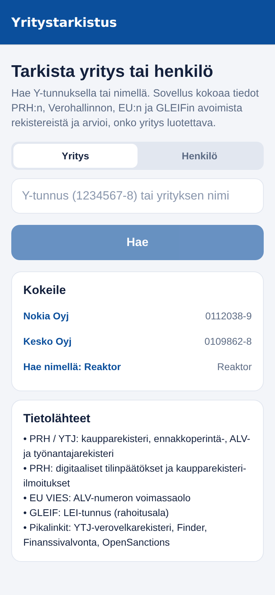
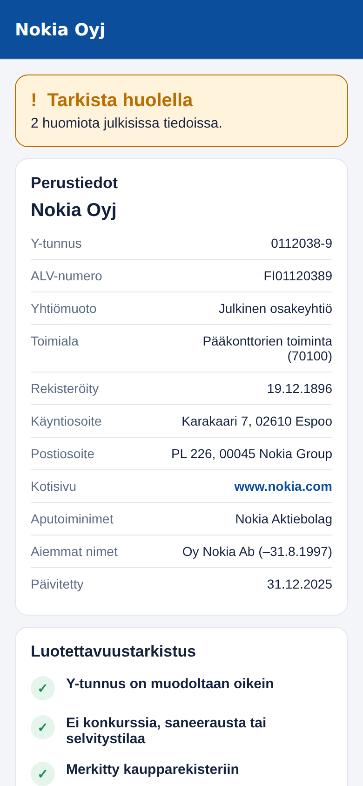
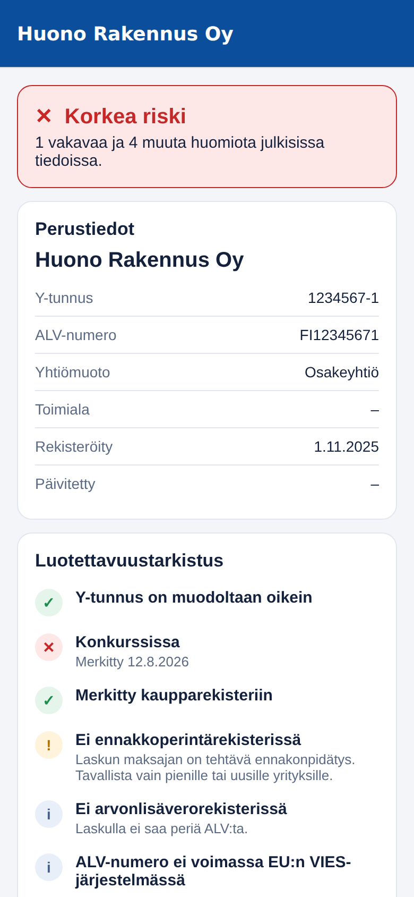
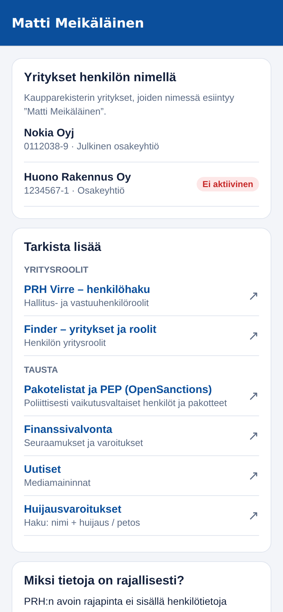

# Yritystarkistus – mobiilisovellus

Suomenkielinen mobiilisovellus (iOS + Android, Expo / React Native), jolla tarkistat yrityksen
**Y-tunnuksella** tai **nimellä** ja henkilön **nimellä**. Sovellus kokoaa tiedot avoimista
viranomaisrajapinnoista ja antaa luotettavuusarvion.

| Haku | Yritys | Riskiyritys | Henkilö |
|---|---|---|---|
|  |  |  |  |

*(Kuvakaappaukset on otettu testiaineistolla.)*

## Mitä sovellus näyttää

**Yritys (Y-tunnus tai nimi)**
- Perustiedot: nimi, aputoiminimet, aiemmat nimet, yhtiömuoto, toimiala, osoitteet, kotisivu, rekisteröintipäivä
- Rekisterit: kaupparekisteri, ennakkoperintärekisteri, ALV-rekisteri, työnantajarekisteri
- Konkurssi, yrityssaneeraus ja selvitystila
- Talous: liikevaihto, liikevoitto, tulos, tase, oma ja vieras pääoma, omavaraisuusaste ja liikevoitto-% (enintään 3 tilikautta)
- Kaupparekisteri-ilmoitukset vuodesta 2014
- EU:n ALV-numeron voimassaolo (VIES) ja LEI-tunnus (GLEIF, rahoitusala)
- **Luotettavuustarkistus**: tarkistuslista ja kokonaisarvio *Ei merkittäviä riskejä / Tarkista huolella / Korkea riski*
- Pikalinkit: YTJ (verovelkarekisteri), PRH Virre, Finder, Finanssivalvonta, EBA:n maksulaitosrekisteri, uutiset, huijausvaroitukset ja OpenSanctions

**Henkilö (nimi)**
- Kaupparekisterin yritykset, joiden nimessä henkilön nimi esiintyy
- Pikalinkit: yritysroolit (Virre, Finder), pakote- ja PEP-listat, Finanssivalvonta ja uutiset

## Tietolähteet

| Lähde | Rajapinta | Avain |
|---|---|---|
| PRH / YTJ | `avoindata.prh.fi/opendata-ytj-api/v3` | ei |
| PRH digitaaliset tilinpäätökset | `avoindata.prh.fi/opendata-xbrl-api/v3` | ei |
| PRH kaupparekisteri-ilmoitukset | `avoindata.prh.fi/opendata-registerednotices-api/v3` | ei |
| EU VIES | `ec.europa.eu/taxation_customs/vies/rest-api` | ei |
| GLEIF | `api.gleif.org/api/v1` | ei |

PRH:n data on lisensoitu CC BY 4.0 -lisenssillä, ja lähde mainitaan sovelluksessa.

### Rajoitukset (tärkeää)
- **Toiminimet** (yksityiset elinkeinonharjoittajat) eivät näy PRH:n avoimessa rajapinnassa. Avaa YTJ-linkki.
- **Tilinpäätökset** löytyvät vain, jos yritys on jättänyt ne digitaalisessa iXBRL-muodossa (noin 5 % yrityksistä). Muiden yritysten luvut löytyvät Finder- ja Virre-linkeistä.
- **Hallitus, omistajat ja henkilöroolit** eivät kuulu avoimeen dataan. Ne löytyvät Virrestä (osin maksullinen).
- **Verovelka** näkyy YTJ-palvelussa, jolla ei ole avointa rajapintaa (linkki sovelluksessa).
- **Finder, Fonecta, Kauppalehti ja Asiakastieto**: palvelujen käyttöehdot kieltävät automaattisen tiedonkeruun, joten sovellus avaa ne selaimessa haku valmiiksi täytettynä eikä kaavi niitä.
- **Traficom**: ajoneuvon omistajatiedot eivät ole avointa dataa.
- **Yksityishenkilön** osoite-, puhelin- ja ajoneuvotietoja ei kerätä (GDPR).

Luotettavuusarvio on suuntaa antava eikä korvaa luottotietoja.

## Käynnistys

```bash
cd yritystarkistus
npm install
npx expo start        # skannaa QR-koodi Expo Go -sovelluksella (iOS / Android)
```

Testit ja tyyppitarkistus:

```bash
npm test              # yksikkötestit (Y-tunnus, PRH-jäsennys, XBRL, riskiarvio, API-asiakkaat)
npm run typecheck
```

Julkaisu sovelluskauppoihin: `npx eas-cli@latest build --platform all`.

## Rakenne

```
src/app/            näkymät (Expo Router)
  index.tsx         hakunäkymä (Yritys / Henkilö)
  haku.tsx          nimihaun tulokset
  yritys/[id].tsx   yrityksen raportti
  henkilo.tsx       henkilöhaku
src/lib/            tietolähteet ja logiikka
  ytunnus.ts        Y-tunnuksen tarkistus
  prh.ts            YTJ-rajapinta
  financials.ts     XBRL-tilinpäätösten jäsennys
  sources.ts        ilmoitukset, VIES, GLEIF
  risk.ts           luotettavuustarkistus
  links.ts          pikalinkit
test/               yksikkötestit
```

Huom: verkkoversiossa (`expo start --web`) selaimen CORS-rajoitukset voivat estää osan rajapinnoista.
Sovellus on tarkoitettu ajettavaksi puhelimessa.
